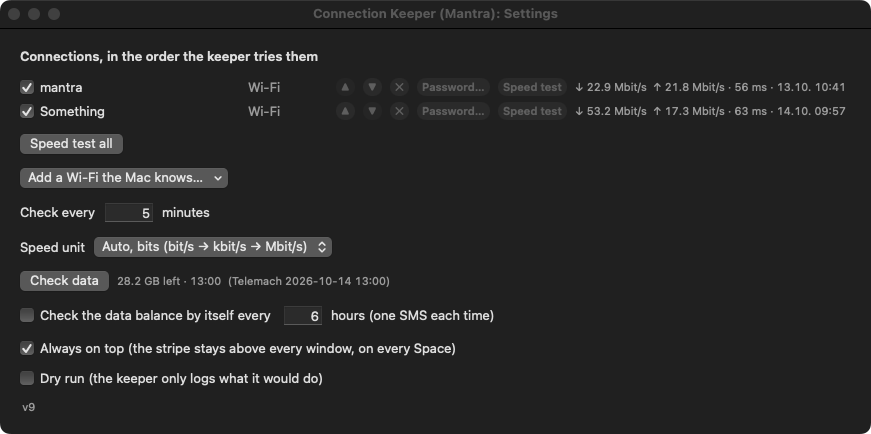

# Connection Keeper (Mantra)

```
git clone https://github.com/markoboskoauroville/connection-keeper.git && cd connection-keeper && ./build.sh && ./agent.sh load
```

Keeps the Mac online. A keeper (LaunchAgent) checks the internet every 5 minutes (ping 1.1.1.1, then an HTTP
probe), and when it is gone it walks a ladder: retry, rejoin the same Wi-Fi, join the next one in the list
(`mantra`, `Something`), switch the Wi-Fi power off and on, then back off and try again. A floating stripe shows
the connection, its live speed, the ping, the last check and the last failover, with a drop-down to switch by hand
and a gear for the list.

Stop the keeper:

```
./agent.sh unload
```

| Document | For whom |
|---|---|
| [TAKEOVER.md](TAKEOVER.md) | the next session: how it works now, the files, what has never been proven |
| [LESSONS.md](LESSONS.md) | anybody about to change a decision: what was learned and why it is so |
| [momentaryupdates.md](momentaryupdates.md) | Marko's requests, word for word, with their status |

## Press the ping (v3, 13.10.2026)

The "ping" on the stripe is a button. Press it and the stripe pings 1.1.1.1 itself (with the HTTP probe behind it), keeper running or not, and says the answer on the status line: **ALIVE ✓** and the time in green with the ping in ms, or **NOT ALIVE ✗** in red. The answer stays 20 seconds, then the usual reading returns.

## Red after a failover (v4, 14.10.2026)

When the keeper leaves a dead connection by itself (mantra stops answering, the keeper moves to Something), every
word on the stripe turns red, so it is seen from across the room, and the failover field says which connection died
and when: **mantra died 09:41 → on Something**. It stays red, through restarts of the stripe, the keeper or the Mac,
until **OK** on the stripe is pressed (or the red words are clicked), or until the Mac is back on the connection that
died. A switch made by hand from the drop-down never turns it red. Settings shows the same line in red at the top.


Try it without touching the network (the test alert stays until OK):

```
"/Applications/Connection Keeper (Mantra).app/Contents/MacOS/connection-keeperd" --simulate-failover mantra Something
```

## The switch that really switches, and NO OTHER CONNECTION (v5, 14.10.2026)

Choosing a connection in the drop-down now starts the join at once: the status line says **switching to mantra…**,
then **on mantra ✓ 10:39** in green, or in red why not (**✗ Something: not in range**). On macOS 15 a program may
join a password-protected Wi-Fi only with its password, so each Wi-Fi gets its password once in ⚙ → **Password…**
(kept in the login keychain), or the app gets the Accessibility permission and switches through Control Centre the
way a hand does. When the connection in use is dead and no other one in the list works, the status line says in
bold red **NO OTHER CONNECTION — mantra dead, Something not working**, until a connection works again.


## Always on top, and the switch through Control Centre (v6, 14.10.2026)

The stripe stays above every window, on every Space and beside full-screen apps; ⚙ → **Always on top** turns it into
an ordinary window and back, and the choice is remembered. With the Accessibility permission (granted 14.10.2026) a
switch from the drop-down presses the network in Control Centre's Wi-Fi list, as a hand would, when the password way
is not there. Check the road without switching:

```
open -n "/Applications/Connection Keeper (Mantra).app" --args --check-join    # one line in the log: CHECK join path …
```

## Pipes, not empty space (v7, 14.10.2026)


The items sit close with a dim pipe between them and the stripe is only as wide as its words. If its remembered place
is on no screen, it comes back to the top middle of the main screen.

## How much data is left (v8, 14.10.2026)


The stripe shows what is left on the Telemach SIM in the TP-Link router: **28.2 GB left · 13:00** (the time is the
one in Telemach's SMS), amber below 10 GB, red below 2 GB. A click on it, or ⚙ → **Check data**, asks again: behind
the scenes the command `router-sms balance --json` (repo [router-sms](https://github.com/markoboskoauroville/router-sms))
sends STANJE to 13880 through the router with a headless browser and reads the reply; the stripe says
"checking data…" meanwhile and never waits. Each check is one SMS, so the automatic check (⚙, every N hours) is off
until he turns it on. Measured: 13.6 s and 11.4 s from the click to the answer.

```
open -n "/Applications/Connection Keeper (Mantra).app" --args --check-data     # the same as a click
```

## A stripe that holds still, the speed unit, Settings with margins (v9, 14.10.2026)


Every item on the stripe has a fixed width and every number a fixed number of places (four digits, right-aligned,
monospaced), so the stripe no longer "breathes" as the speed changes; ⚙ sits at the left end, next to the dot, where
it never moves. ⚙ → **Speed unit**: Auto in bits (bit/s → kbit/s → Mbit/s, the default), Auto in bytes
(B/s → kB/s → MB/s), or one fixed unit (bit/s, kbit/s, Mbit/s, Gbit/s, B/s, kB/s, MB/s, GB/s); the speed test results
follow it. Settings takes the size its content needs, 20 points from every edge.



## Internet speed only, never the local network (v10, 14.10.2026)


The speed on the stripe, now labelled **internet**, counts only what goes through the router to the internet: the
kernel's byte counters of the default route (`nettop -m route`, "default -> en0 -> 192.168.1.1"), TCP and UDP. v1 to
v9 counted everything on en0, so a transfer to the phone at 192.168.1.103 showed as internet speed. Measured during a
150 MB adb push to the phone (3.6–3.9 MB/s on the local network): en0 3605–3924 kB/s out, the stripe 0–26 kB/s.

## The data check in front of his eyes (v11, 18.10.2026)

A click on the data item (or ⚙ → Check data) now runs `router-sms balance --visible --json`: a Firefox window opens
on the router, logs in (the password typed dot by dot), writes STANJE to 13880 letter by letter, sends it, waits in
the Inbox, opens Telemach's reply when it comes and holds it on the screen for 15 s, then closes; the stripe shows
the result. The same script every time, no AI. Nothing else may stay logged in to the router meanwhile (it allows one
session; MANTRA_MANIFEST modules/tp-link-router.md).

**The speed test on speedtest.net.** Beside the live internet speed the stripe keeps the last speedtest.net result,
**test ↓ 33.1 ↑ 25.2 · 01:15** (Mbit/s). A click on it, or on the live speed, runs `speedtest-firefox --visible`: a
Firefox window opens speedtest.net, declines the cookie banner, presses GO and shows the result for 10 s (about 45 s
in all).

**Behind the scenes at every start, and once on a new day.** Five seconds after the stripe starts it asks the data
left, then runs the speed test, both headless, nothing on the screen; past midnight it does both again if the day has
no value yet. Only a click by hand opens a window.

```
speedtest-firefox [--visible] [--json]     # Tools/speedtest-firefox, linked into ~/.local/bin
```

## One line, less of it, colours instead of words (v12, 18.10.2026)


The stripe says only what matters, in one line (MANTRA_MANIFEST modules/one-line-stripe.md): the connection (green
on Wi-Fi, yellow on a cable, USB adapter or phone), the live internet speed with the last speedtest.net result in
parentheses (download green, upload red, no arrows, no time), the ping in yellow, the data left ("98.5 GB left", no
time). "checked … ago" and "failover … ago" are gone; the status place appears only when it has something to say
(NO OTHER CONNECTION, a ping answer, a switch), the failover place only in the red alert. At every start the ping,
the data and the speed test run at once behind the scenes, and each place says (...) until its answer comes.

The speed test's Firefox keeps one profile, `~/Library/Application Support/connection-keeper/firefox`: an add-on
installed there once (uBlock Origin, against the advertisements) stays for every test.

## Aggregation: two lines at once (v13, 18.10.2026)

The app has a third program, `ck-aggregate`, the **aggregation server**: a proxy on 127.0.0.1:8857 (SOCKS5 and HTTP on
one port, the LaunchAgent `com.mantra.connectionkeeper.aggregate`). Every new connection goes out through one of the
joined lines, bound to its device, and the faster line gets more of them. A browser, a download manager or a speed test
opens many connections at once, so it uses both lines together. One single connection still stays on one line.

Only lines that leave the house through **different** devices are joined: the cable and the Wi-Fi through the same
TP-Link (the same public IP or the same router MAC) are one line, and the Wi-Fi is ignored (request 25).

**The stripe** has one row per connection, and the **JOINED** row at the bottom (request 27): each row shows its own
live speed, its ping and whether it is joined. The JOINED row shows the lines joined, their speeds added, the
connections the server holds, and the last joined test against the best single line.

**The drop-down selects** (request 28): under JOIN, a tick box for every connection online now (the menu stays open).
Any tick turns aggregation on, which points macOS's SOCKS proxy at the server. No tick turns aggregation off, and the
proxy goes back off. If the server stops answering for 15 s, the stripe switches the proxy off at once, restarts the
server, and switches the proxy on again when the server answers.

```
ck-aggregate uplinks      which lines are different, which are ignored
ck-aggregate test [s]     each line alone, then all through the server (s seconds each, default 6; SIM data is printed)
ck-aggregate on | off     macOS's proxy → the server, or off (the ticks do this)
```
(`/Applications/Connection Keeper (Mantra).app/Contents/MacOS/ck-aggregate`; the server's words: `curl 127.0.0.1:8857/status`.)

## mantra_networkaggregate: the virtual device (v14, 18.10.2026)

macOS uses a virtual network device, **mantra_networkaggregate** (utun99), as its connection and knows nothing about
aggregation; the device does it. A small root helper, `ck-tunnel` (the LaunchDaemon
`com.mantra.connectionkeeper.tunnel`), runs hev-socks5-tunnel (MIT) on utun99 and sends all IPv4 internet traffic
into it with two half routes. hev hands every connection, TCP and UDP, to the aggregation server, which sends it out
over the joined lines. It is free: a real Network Extension would need a paid Apple developer account.

Install once, with your password (it copies the helper out of the installed app into /Library/PrivilegedHelperTools):

```
sudo ./tunnel.sh install        # sudo ./tunnel.sh uninstall to remove it; ./tunnel.sh status
```

After that the JOIN ticks switch the device: any tick and it carries the internet (the stripe's first row reads
mantra_networkaggregate, the lines have rows under it); no tick and the Mac is straight on its lines. If the server
stops answering for 6 s, the helper removes its routes by itself, so the internet never dies with it.

On a fresh clone the build fetches hev-socks5-tunnel 2.19.0 once and checks its fingerprint (it is not kept in the
repository).

Proven 18.10.2026 (a 5-minute test run): plain downloads with no proxy set, 73.8 Mbit/s through the device, both lines
carrying (cable 19.4 MB + Something 34.7 MB in 6 s); name lookups, UDP to 1.1.1.1, the web and the keeper all fine;
the stripe showed cable 26.0 + Something 54.1 = JOINED 80.1 Mbit/s live.
