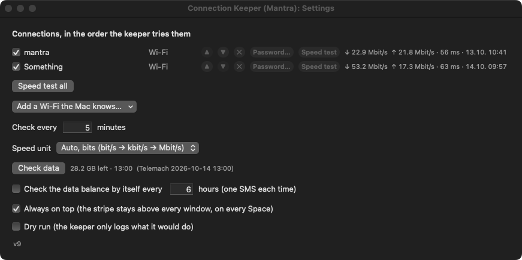

# connection-keeper: takeover

**28.10.2026, 23:37: the v32 tunnel helper is installed** (Marko typed `sudo ./tunnel.sh install`; the first try hit
"Bootstrap failed: 5", fixed in tunnel.sh). Since 23:36:45 the log says UP: utun99 carries the internet
(mantra_networkaggregate); watched for a minute: 3 routes on utun99 the whole time, internet answering. Before the fix
the routes "vanished" within 2.5 s in WIRES. Still to watch: that it stays up for hours, and through a WIRES / WI-FI switch.

**Version v10** (14.10.2026) · repository markoboskoauroville/connection-keeper (private) · artefact `10-connection-keeper-v10.zip`, tag `v10`
The reasons behind the choices are in [LESSONS.md](LESSONS.md).

## What it is

Marko has two access points, `mantra` and `Something` (the SSIDs exactly as the Mac's preferred networks list
them). When one loses the internet the Mac stays on it, so nothing works until somebody switches by hand. The
keeper does the switching, and the stripe shows what is happening and lets him switch himself.

## The model

| What | Where |
|---|---|
| The list of connections, interval, probes, dry run | `~/.config/connection-keeper.json` (written by the gear; the keeper re-reads it every 2 s) |
| The keeper's state, heartbeat every 2 s | `~/Library/Application Support/connection-keeper/state.json` |
| A request from the stripe (`switch` / `check`) | `…/connection-keeper/command.json`, taken and deleted by the keeper |
| The red alert after an automatic failover (v4): `{from, to, at, how, simulated}` | `…/connection-keeper/failover-alert.json` |
| One keeper only | `…/connection-keeper/keeper.lock` (flock) |
| The log | `~/Library/Logs/connection-keeper.log` (launchd's stderr: `connection-keeper.err.log`) |
| The LaunchAgent | `~/Library/LaunchAgents/com.mantra.connectionkeeper.plist`, label `com.mantra.connectionkeeper` |

A connection is `{kind, name, interface?, enabled}`. Only `kind: "wifi"` has a driver in v1; any other kind stays in
the list and is skipped with a log line. A new kind (ethernet, USB, iPhone tether) is one `Driver` in
`Sources/Daemon/main.swift` and one entry in `drivers`; the ladder does not change.

**The check:** `ping -c 3 1.1.1.1`; if it fails, `http://captive.apple.com/hotspot-detect.html` must answer
"Success". A page that answers with something else is a captive portal (offline). Online when either passes.

**The ladder, when offline:** two retries 15 s apart → rejoin the current SSID → each other enabled connection in
order → Wi-Fi power off 5 s and on → each enabled Wi-Fi again → back off 60, 120, 240 s … up to the interval.
Every step is logged; a change of network that brings the internet back is logged as `FAILOVER a -> b` and shown
on the stripe. It does not switch back to the first network while the second works (no flapping).

## Joining a Wi-Fi (v5)

`Join.wifi` in `Sources/Shared/Join.swift` is the only way in, for the keeper's ladder, the drop-down and the speed
test. In order: `networksetup -setairportnetwork` alone; then with the password from the login keychain (service
`com.mantra.connectionkeeper.wifi`, account = SSID, set in Settings → Password…, readable by the app and the keeper
without a prompt); then Control Centre's Wi-Fi list pressed through the accessibility API (identifiers
`com.apple.menuextra.controlcenter`, `controlcenter-wifi`, `wifi-network-<SSID>`; only when `AXIsProcessTrusted()`).
Each step is believed only when `ipconfig getsummary` names the SSID and the interface has an address. The detail
string says which step worked or why each failed. In the keeper the join runs on a second thread so the heartbeat
keeps beating.

The drop-down joins from the stripe itself, at once, keeper or not, with the keeper's checks held
(`speedtest.hold`); the keeper looks again as soon as a hold ends. It never raises the red alert.

**NO OTHER CONNECTION:** when the ladder ends with nothing working, the keeper's phase begins with
`NO OTHER CONNECTION` (`noOtherPrefix`) and the log says so; the stripe shows the phase bold red, wide, dot red, until
`online()` sets the phase back to `ok`.

## Always on top and the Control Centre road (v6)

`OnTop` (stripe's UserDefaults key `alwaysOnTop`, default true): on = window level `.statusBar` (25) with
`canJoinAllSpaces, fullScreenAuxiliary, stationary`; off = level `.normal`. ⚙ has the checkbox; a notification applies
it at once. Measured: layer 25 on, 0 off.

Control Centre does not open over a full-screen app (nothing over full-screen iTerm, the panel at once with Finder in
front), so `ControlCenterWifi.click`/`list` bring Finder forward, act, close the panel and give the front back to the
app that had it. `--check-join` (run with `open -n … --args --check-join` so the app's own Accessibility permission is
what counts, not the terminal's) logs `CHECK join path: accessibility granted; Control Centre Wi-Fi list read: mantra,
Something; stored passwords: …` and presses nothing. The Accessibility permission survived the rebuilds (stable
"Mantra Apps" signature).

## The stripe's layout (v7)

Labels have a maximum width, not a fixed one (`label(max)`, hugging required); a dim "|" label sits between the items;
`fit()` runs on every refresh and resizes the panel only when the fitting width changed, keeping the left edge.
`keepOnScreen()` (at start and after every fit) moves the stripe to the top middle of the main screen when less than
80 points of it are on any screen and logs it.

## Internet speed only (v10)

`Traffic.internet(iface)` (Net.swift) runs `nettop -x -n -L 1 -m route` (about 10 ms) once a second off the main thread
and sums bytes_in / bytes_out of the routes whose destination is `default` on the interface of the default route
(IPv4 and IPv6). Those counters carry only traffic to the internet, TCP and UDP; the local subnet has its own route
("192.168.1/24 -> en0") and the router its host route, neither counted. Measured 14.10.2026: a 20 MB download +20.4 MB
on the default route, 3 MB of UDP to 1.1.1.1 +3.08 MB, a 150 MB adb push to the phone (3.6–3.9 MB/s on en0) 0–26 kB/s
on the default route (the rest of the Mac's internet). A route made again after a network change starts at 0: that
second shows nothing. `Traffic.counters` (all of en0) is no longer used by the stripe.

## Fixed widths and the speed unit (v9)

The stripe's order is dot · ⚙ · connection ▾ | speed | ping | data | status | failover [OK]. Every item has an
*equal* width constraint (v7 had a maximum, which let the stripe change width with every number): the connection gets
the longest name in the list, speed the widest text of the chosen unit (`speedSample()`), ping "ping 999 ms", data
"888.8 GB left · 88:88", status "checked 59 min ago ✓", failover "failover 59 min ago". The width changes only with
the state (red alert, NO OTHER CONNECTION, a message on the status line), and the left edge stays, so ⚙ never moves.
Numbers are in `monospacedSystemFont`, four significant digits in a five-character slot (`SpeedUnit.slot`).
`Sources/Shared/Units.swift`: `SpeedUnit` (stripe's defaults key `speedUnit`, default `autoBits`), decimal steps of
1000, the unit padded to the family's widest. Measured 14.10.2026: three shots 3 s apart, 956 points each (bits),
926 each (bytes). Settings: `sizeToContent()` after every rebuild; NSStackView's fittingSize leaves out the right
inset when one row is wider than the rest, so the width is the widest row plus both insets.

## The data balance (v8)

`Sources/App/DataBalance.swift`. The stripe's item `data` (between ping and the status) shows
`…/connection-keeper/data-balance.json` (written at every successful check, read at start): "%.1f GB left · HH:MM",
the time from Telemach's SMS; amber < 10 GB, red < 2 GB, red with the failover alert. A click (or ⚙ → Check data, or
`--check-data` at launch) runs `~/.local/bin/router-sms balance --json` on a background thread, timeout 150 s, and
logs `DATA balance asked` and `DATA … MB left of … (N s from the click)` or `DATA balance FAILED: why` (the item then
says "data ✗" in red for 30 s, the reason in its tooltip). The automatic check: UserDefaults `dataBalanceEveryHours`,
0 = off (the default), checked every minute against the file's age. The SMS itself is done by router-sms
(~/Developer/ROUTER_SMS, its own TAKEOVER): a headless Firefox of its own logs in to the router at 192.168.1.1,
sends STANJE to 13880 and parses the reply; its warm server (LaunchAgent com.mantra.routersms, 127.0.0.1:8880) keeps
the login, so a check is the SMS's own time plus a few seconds.

## The red alert (v4)

When `attempt()` brings the internet back on a different connection and the switch was not asked from the stripe
(`manual` is false), the keeper writes `failover-alert.json` (`raiseAlert`). `from` is the connection that died, `at`
is when the check first found it offline. A second failover keeps the first `from`; a failover back onto `from`
deletes the file. `online()` also deletes it when the keeper is healthy on `from` again (`clearAlertIfHome`).
The stripe reads the file every second (`applyAlert`): every word red, the dot red, the failover field in bold
"mantra died 09:41 → on Something" (wider), and an **OK** button; OK or a click on the red words deletes the file
and logs "ALERT acknowledged". Without the keeper, the stripe itself clears it when its own reading of the SSID is
`from`. A `simulated` alert (`connection-keeperd --simulate-failover [FROM TO]`) never clears by itself, only by OK.
Settings shows the line in red above the list when it opens.

## The screens

- **The stripe** (floating, all Spaces, dragged anywhere, position remembered): state dot (green running, amber
  dry run or recovering, red offline, grey keeper not running) · current connection ▾ (the drop-down: the list,
  Check now, Open the log, Quit) · ↓ ↑ speed of the interface carrying the default route, per second · ping ·
  last check, or the keeper's phase in amber while it works · time since the last failover · ⚙.
- **Settings** (⚙, or launch with `--settings`): the connections with on/off, ▲ ▼ ✕; "Add a Wi-Fi the Mac
  knows…" (the Mac's preferred networks); check interval in minutes; dry run; `v1`, a click opens the latest release.

## The dangerous parts

- The keeper changes the network: `networksetup -setairportnetwork` and `-setairportpower`. A wrong ladder cuts
  the Mac off. `--dry-run` (or "Dry run" in settings) makes every act a log line.
- `networksetup` answers status 0 even when it fails; the keeper treats any output as a refusal and then believes
  only the SSID (`ipconfig getsummary`) and an IP address.
- The manual switch from the stripe joins directly when the keeper is not running.

## The files

| File | What |
|---|---|
| `Sources/Shared/Model.swift` | version, paths, Config, KeeperState, KeeperCommand |
| `Sources/Shared/Net.swift` | shell helper, SSID/route/preferred networks, join, power, probe, traffic counters |
| `Sources/Shared/Join.swift` | v5: the join road (networksetup, stored password, Control Centre), the keychain item |
| `Sources/Daemon/main.swift` | the keeper: drivers, the ladder, the loop, the lock |
| `Sources/App/main.swift` | the stripe |
| `Sources/App/Settings.swift` | the gear's window |
| `Sources/Shared/Units.swift` | v9: the speed unit and the fixed number slots |
| `Sources/App/DataBalance.swift` | v8: the data balance through `router-sms` |
| `Tools/make_icon.swift` | the icon, drawn in code, version under the symbol |
| `Resources/Info.plist` | bundle (LSUIElement: no Dock icon) |
| `launchd/com.mantra.connectionkeeper.plist` | the LaunchAgent template |
| `build.sh` / `agent.sh` | build + sign + install / load, unload, status |

## Building

`./build.sh`: both binaries with swiftc, the icon, signed "Mantra Apps", installed in
`/Applications/Connection Keeper (Mantra).app` (the keeper is `Contents/MacOS/connection-keeperd`), zipped as
`build/N-connection-keeper-vN.zip`. A new version: raise `CKVersion` in `Model.swift`, build, tag `vN`, release the
zip, delete the release before last.

Test the ladder without touching the network:

```
"/Applications/Connection Keeper (Mantra).app/Contents/MacOS/connection-keeperd" --simulate-offline --fast --once
```

## What has never been proven

- **The automatic data check has never fired** (off by default); amber and red for the data item were never seen
  (28.2 GB left). Proven 14.10.2026: two real checks from the stripe, 12:58 and 13:00, 28837.12 MB left.

- **A join with a stored password and a join through Control Centre from the app have never run.** Marko has not
  typed the passwords yet and the app had no Accessibility permission (granted later on 14.10.2026; v6's `--check-join` read the Wi-Fi list at 11:19, still never pressed a row from the app). Proven: networksetup alone fails
  on macOS 15 (live test, see LESSONS), a pressed Control Centre row switches at once (done by hand through
  accessibility from the terminal, 10:06), the drop-down answers at once with the reason ("not in range"), the
  NO OTHER CONNECTION line seen red with `--simulate-offline`.

- **The red alert has never followed a real failover.** Verified 14.10.2026 by `--simulate-failover`: red stripe
  seen (docs/v4-red-after-failover.png), still red after quitting and reopening the stripe, OK pressed through
  accessibility cleared it and logged it, and a non-simulated alert from `mantra` while on mantra cleared itself.
  `raiseAlert` inside the keeper runs only after a real network change.

- **No real failover has happened.** v1 to v4 could not have made one: networksetup without a password does not join
  on macOS 15 (LESSONS).
- The Wi-Fi power cycle has never been run.
- The LaunchAgent was loaded on 14.10.2026 and ran; start at login and restart after a crash are untested.
- A captive portal has only been reasoned about, never met.
- The stripe's speed was seen moving (5 kB/s → 198 kB/s) but not compared against another meter.

## State on 18.10.2026 (v12)

- The stripe: connection (green Wi-Fi / yellow other) | speed with the last speedtest.net result in parentheses
  (green down, red up) | ping (yellow) | data left; the status and failover places only when they have something to say.
- A click on the speed runs `speedtest-firefox --visible` (Tools/, linked into ~/.local/bin; kept profile
  ~/Library/Application Support/connection-keeper/firefox); a click on the data runs `router-sms balance --visible`.
- At start: pingNow, then `router-sms balance` then `speedtest-firefox`, both headless; again once past midnight
  (`newDay`). Each speed test costs about 100 MB of the SIM.
- The router-sms warm server is unloaded and must stay so (one router session).
- Never proven: the red alert's look with the v12 hidden places (`--simulate-failover`), the yellow colour on a cable
  or tethered phone (no cable plugged in on 18.10.2026).

## State on 18.10.2026 (v13): aggregation

- `Sources/Aggregate/main.swift`: `ck-aggregate` (serve / uplinks / test / on / off). It finds the lines (devices with
  a router that answer a ping through themselves), groups them by public IP or router MAC (one per group, the cable
  first), and gives every new connection to the line with the fewest connections for its speed. If a line cannot reach
  the host, the next line is tried. Health check every 20 s, lines found again every 60 s or at once when the ticks change.
- `Sources/Shared/Aggregate.swift`: the ticks (`aggregate-selection.json` in Application Support/connection-keeper),
  the server's /status, the last test (`aggregate-test.json`), macOS's SOCKS proxy on/off.
- `Sources/App/Lines.swift`: the stripe's extra rows, the JOINED row, the JOIN ticks, the server watcher.
- `launchd/com.mantra.connectionkeeper.aggregate.plist`; `agent.sh load` loads both agents, `unload` stops both and
  switches the proxy off. Log: `~/Library/Logs/connection-keeper-aggregate.log`.
- **Never proven:** two really different lines (the Mac's Wi-Fi on Something, the cable on mantra), so the speed gain is
  not measured yet; Marko's ticks; a whole day with the proxy on; Chrome with QUIC (Chrome turns QUIC off behind a SOCKS
  proxy, which is what we want). One single download stays on one line: the next step is a server outside (LESSONS).
- Every start of the stripe still runs the data SMS and a speedtest.net test (about 100 MB of SIM data).

## State on 18.10.2026 (v16): the mode switch

- `Aggregation.aggregateMode` (Shared/Aggregate.swift) is the file `mode` in Application Support ("one" / "aggregate"; missing
  = the old flag decides). `Aggregation.on` = aggregate mode AND lines ticked. `setMode` does the whole switch: on =
  launchctl enable + bootstrap + kickstart of com.mantra.connectionkeeper.aggregate, then `apply(true)`; off = `apply(false)`,
  the proxy off, bootout + disable of the agent.
- App/Lines.swift: `toggleMode` on the last row's name, `addModeSection` at the top of ▾; ticking none still means off.
- Tunnel/main.swift: `trafficPasses()` (two Cloudflare addresses by IP, 4 s each), checked 4 s after up and every 10 s;
  `rest()` = down + five minutes before up is allowed; route re-adds counted per minute.
- On 18.10.2026 at 12:40 the Mac is on ONE CONNECTION, the tunnel-on flag removed, the helper not running (still v14 in
  /Library/PrivilegedHelperTools until Marko runs `sudo ./tunnel.sh install`).
- Never proven: the v15 helper as root (needs his sudo); a fail-open triggered for real; AGGREGATE CONNECTION on screen.
  AX88179B (the USB-C cable) showed "no internet" at 12:36, not looked into.

## v17 (19.10.2026): phone lines over adb

`Sources/Shared/Phones.swift` lists the phones on a USB cable (`adb devices -l`, `usb:` only, not the emulator), names them "<maker> <model> (USB)", and `ensure()` pushes `Contents/Resources/phone/ck-phone` (built by build.sh from `Sources/Phone/main.go`, GOOS=linux GOARCH=arm64) to /data/local/tmp when its sha256 differs, starts it on the phone's 127.0.0.1:8858 and forwards Mac 127.0.0.1:8860+n to it. A phone's device is "adb:<serial>"; ck-aggregate's `Uplink.phone` dials it as SOCKS5 (`Phones.dial`), its health is a connection to 1.1.1.1:443 through it, UDP never goes to it; the test counts it on the phone's /proc/net/dev. The stripe ensures it too (every scan; cheap when it answers) and draws its speed from the server's byte counters. Known: `ensure` only pushes a new ck-phone when the old one stops answering (kill it on the phone after a change).

## v21 (28.10.2026): WIRES or WI-FI

The switch beside ⚙ runs `Resources/ck-wires wires|wifi --json` (Sources/App/Wires.swift); the mode is the file
`wires` in Application Support, the radios before WIRES are in `wires-state.json` (deleted by WI-FI). The router is
switched by `router-sms wifi on|off` (ROUTER_SMS v3, one session on the router: never run it beside another router-sms
job). The phone's hotspot is the Quick Settings tile (no shell command on the Nothing). Never proven: a phone that is
locked with a PIN (the tile may ask to unlock), and two phones on USB at once. Left in WIRES on 28.10.2026.

## State on 28.10.2026, 15:20 (v29)

The stripe: one line `🟡 ⚙ ▸ connection | speed (test) | ping | data | status ‖`. 🟡 = macOS minimize (TrafficMinimize,
main.swift); ⚙ = a menu with WIRES / WI-FI (Wires.swift) and Settings…; ▸ opens only the lines connected now (Lines.swift,
`shown`); "connection" while aggregating, else the line's name; ‖ = Grip, drags the scale (stripeScale in the stripe's
defaults, 0.5–3×; the root is a FlippedView whose bounds keep the natural size). Every field is a fixed slot (tighten()
in main.swift sets the widths from samples: speedSample(), "ping 999 ms", "888.8 GB left", statusSample), so the width
never changes (813 points at 1×). Colours: green connected, red here but not connected, grey gone (seen-lines.json; grey
rows are no longer shown on the stripe since v24, the ▾ menu still greys what is not available). No dots (v28).
Mode on 28.10.2026: WIRES (Mac Wi-Fi, TP-Link Wi-Fi and the phone's hotspot off), AGGREGATE CONNECTION over AX88179B +
Nothing A142 (USB). Marko: "everything working great".
Never proven: the drag by a hand other than his (he confirmed "all works" on v28); the ⚙ menu opened by Accessibility
(pop-up menus need a real click).

## State on 28.10.2026, 22:50 (v32): ⟳ RESCAN, plugged devices, the pipe leak

- **The pipe leak** (the cause of request 49): `shell()` leaked one pipe per call in every program without a run loop
  (ck-aggregate, connection-keeperd); the stripe drains its pool and did not. ck-aggregate had 2473 pipes after 6.5 h,
  every program it ran gave empty output, `discover()` found nothing and `/status` said `"lines": []` from 17:58.
  `shell()` now runs in `autoreleasepool` and closes both ends; the tunnel helper's `run()` the same.
- **⟳** (`rescan` in main.swift, `rescanNow()`): writes `aggregate-rescan` (Aggregation.requestRescan); the server's
  watcher (closure in `Server.run`, every 1 s) deletes it, `rescan()` = refresh + every line probed now
  (`lastGood` reset), and writes `aggregate-rescan-done` (time, then "name (alive|silent)" per line); the stripe waits
  up to 30 s (`rescanAnswer(since:)`) and shows "N LINES ✓ HH:MM". Not aggregating: the stripe's own scan only. Server
  silent: launchctl kickstart of the agent. Also `--rescan` and the distributed notification `ConnectionKeeperRescan`.
- **Plug detection** (`deviceFingerprint()` in Aggregate/main.swift): the IPv4 devices from getifaddrs (no program)
  plus `adb devices` with each state, every second; a change logs `devices changed (… → …)`, `joinPlugged` ticks the
  entries that appeared (a phone only in state "device", never the Wi-Fi), then refresh + checkLines.
- Measured 28.10.2026: ⟳ answered in 16 s, "2 LINES ✓ 22:37" seen on the stripe (both lines joined). The phone unticked,
  `adb usb` (adbd restarted on the phone, gone 10 s): "plugged in: Nothing A142 (USB): joined", both lines alive 19 s
  after it went. ck-aggregate: 0 pipes after 6 minutes. The ticks were put back as they were.
- Known: a flap shorter than about 1.3 s (`adb reconnect`) can fall between two looks; a real unplug is longer.
- **The tunnel helper (needs Marko's admin password)**: on 28.10.2026 22:27 its log said "routes were gone" while
  `netstat -rn` by hand showed 0/1 and 128.0/1 on utun99 the whole time; the helper had run 16 h with the same leaking
  `run()`, so its own netstat very likely came back empty, it re-added routes, and after four "re-adds" rested five
  minutes (the "macOS deletes the routes" of v31). The fix is in Sources/Tunnel/main.swift and is in the v32 app;
  installing it needs `sudo ./tunnel.sh install` from this folder (or at least a restart of the daemon,
  `sudo launchctl kickstart -k system/com.mantra.connectionkeeper.tunnel`). Never proven until then.

## State on 29.10.2026, 05:05 (v33 + v34): agents loaded by the stripe; a Wi-Fi icon per line

- **v33 (request 50):** macOS Login Items had both LaunchAgents (com.mantra.connectionkeeper, .aggregate) as
  "not allowed in the background" (`sfltool dumpbtm`: disallowed), so after the 04:44 restart nothing loaded them and ⟳
  waited for a server that was not there. `Aggregation.ensureAgents()` (Shared/Aggregate.swift) bootstraps whichever is
  not loaded (the server only in aggregate mode); called at the stripe's start, every 60 s (`loadAgents()` in main.swift),
  on ⟳ when the server is silent, and in watchServer. Log lines "AGENT … loaded it" / "RESCAN: … loaded it".
  Measured: unloaded → loaded back in 57 s; unloaded + ⟳ → both lines alive in 12 s. Marko can also allow both under
  System Settings → General → Login Items → Allow in the Background.
- **v34 (request 51):** `ck-wires share <line> on|off` and `share-status`; state in wifi-share.json. Cable line → router-sms
  wifi (the TP-Link has only 2.4 GHz); phone line ("<maker> <model> (USB)") → hotspot tile; Mac Wi-Fi kept off; a locked
  phone (`dumpsys trust` deviceLocked=1, always after a phone restart) is refused with "unlock it once" in 0.3 s instead of
  tapping; after a hotspot comes on its frequency is read (`dumpsys wifi`, softapinfo) and ≥5000 MHz is a failure.
  WIRES itself sets every share off. Icon: LineRow.wifi inside the lead view (no column moves), Stripe.showShare/toggleShare
  in Wires.swift. AX: the icons are buttons 8 and 9 of the stripe window ("share this line over Wi-Fi").
  **Not yet proven:** the phone's hotspot from the icon and its band (phone was locked); the frequency regex is a guess
  until seen with the hotspot on.

## 29.10.2026, 05:26 (v35): the hotspot tile without uiautomator; no show taps

- ck-wires `tap_hotspot_tile`: two uiautomator reads; a good read stores the tile's centre in phone-tiles.json under
  "<serial> <wm size>"; a failed read ("could not get idle state", common while the status bar's speed redraws) taps the
  stored spot. `hotspot()` taps the same spot again if the state did not change after a blind tap (undo) and drops the
  cache. Nothing A142: tile at 418,656 (1084x2412).
- show_touches is never set (Marko 29.10.2026: "I don't need these tabs").
- Proven from the stripe (AX button 9): off 26 s (blind), on 16 s, 2412 MHz; earlier by hand 2427 MHz. Both lines stayed
  joined. Hotspot left ON (Marko switched it on). The 5 GHz branch is untested (the phone stays on 2.4 GHz).

## 29.10.2026 (v36): the menu bar icon, the LED

- Sources/App/MenuBar.swift: NSStatusItem (SF "network", template) + attributedTitle from `menuBarRate` (Mbit/s, four
  places with figure spaces); fed from `Stripe.setSpeed` (every path: one line, joined lines, tunnel). `internetUp()`:
  aggregating → a joined line alive; else the keeper's lastCheck.online and a default route. `showLed()` in refresh():
  the LED (`led`, last in the first row) and the icon tint (red when down).
- Click = `menuBarClicked`: toggle the panel; MenuBarPrefs.stripeHidden (UserDefaults) survives restarts; applyOnTop
  respects it. minimizeStripe now hides to the icon (no Dock / Command-Tab any more).
- The status item windows are layer 25, 98 points wide; `screencapture -l <id>` shows them without his screen.

- v37 (request 54): the item is drawn like iStat Menus' network item (`showMenuBarSpeed` draws an NSImage: dot 9 pt,
  5 pt gap, two lines of monospaced 9 pt, labelColor, right aligned in the width of "88.88 Mb/s"); upload on top.
  `istatRate`: 2 decimals under 10, 1 under 100, none above. The dot redraws when internetUp() changes.

## 31.10.2026 (v39): the outage fix, ON OFF TOP

- ck-aggregate raises its open files to 16384 (`openFiles`), serves at most 1500 clients (`maxClients`, refused at once
  beyond), gives a client 15 s to say where it goes (`deadline`), keeps a line's Uplink object across refreshes. A phone
  whose `cmd wifi status` says it is not on a Wi-Fi is `cellular` and never "the same line". Why: LESSONS 31.10.2026.
- Test copy: `CK_AGG_PORT=8957 CK_AGG_SELECTION=<json> CK_AGG_TEST=1 CK_AGG_FAULT=<file> ck-aggregate serve`; the fault
  file holds `<line name>=silent|dead`. The harness used on 31.10.2026 (stress.py: bursts 20/100/250/1000, by name, UDP
  DNS, 160 held, 300 silent clients, a line cut silent and dead) is worth keeping in Tools/ next time.
- OnOff.swift: OFF = `OnOff.cleanUp()` then quit, `offByHand` set; a `--login` start then exits; a start by hand clears it
  and, if `resumeAggregate`, sets aggregate mode again. AX identifiers `on`, `off`, `top`.
- Proven 31.10.2026 10:20 by Marko: OFF cleaned up in 2 s (tunnel down, server and keeper stopped, ck-phone stopped and
  its forward removed); ON from the star brought aggregation back. Still open: the restart gap (~7 s while the server finds its lines
  after a restart, the first connections wait) could be shortened by keeping the last lines on disk.

## 31.10.2026 (v40): no ticked line, only phones ticked

- `discover(known:anyLine:)`: when none of the ticked lines is present, the server uses any line with internet (log "no
  ticked line is here: using …"); before, the tunnel carried nothing until it rested (20 s without internet, 10:17).
- Only phones ticked: the Mac's own non-phone lines join for UDP (a phone line is TCP only); UDP 0/10 → 10/10.
- Phones.swift: the maker from getprop only when adb answered cleanly (a phone name had become "adb: device … not found").
- The stress harness is kept in Tools/stress (stress.py, summary.py); it runs a test copy on 8957, never the real 8857.
- utun99 is not a VPN: a local virtual card feeding ck-aggregate; Tailscale (utun1) carries only the tailnet beside it.

## 31.10.2026 (v41, v42): the restart gap and the tunnel's step-aside (request 57)

- ck-aggregate writes its lines to `aggregate-lines.json` (`Lines.remember`) whenever they change; at start it carries
  traffic on them at once (`Lines.remembered`, a device without an address left out; a phone by its serial and port),
  else on every device with a router, and the full search replaces them. Test copy: `CK_AGG_LINES`. Measured: test copy
  6.2 s (v40) → 0.16 s; the live server 0.38 s after `launchctl kickstart -k`. A remembered phone that is gone costs nothing.
- ck-tunnel (needs `sudo ./tunnel.sh install`): a real request every 4 s, 2.5 s in all to answer, a miss checked again
  on the next round (2 s), two misses → down, rest **1 minute** (was 5). Stuck server: ~7–11 s (was ~20).
- v41's helper retried a miss at once: at 13:33:22 the Pixel's cable dropped in the middle of a check, both tries hit
  the dying line, the device stepped aside for a minute. v42 waits a round. **v42's helper is built, not yet installed**
  (Marko's password): the v41 helper runs meanwhile.
- The Pixel 7 drops off USB again and again on 31.10.2026 (13:22, 13:33): the cable (the other session found it charge-only).

## 1.11.2026 (v43): TEST SPEED · TEST HEALTH, the Aggregate Download Monitor, MAC · AGGREGATE · BOTH, 4G · 5G (requests 58–60)

- **ck-net** (Sources/Net/main.swift, Contents/MacOS/ck-net, linked to ~/.local/bin/ck-net): `test health` (10 s, all
  lines at once: ping 1.1.1.1 every 0.2 s from the line itself, `ping -b en17` / `adb shell ping`; five HTTPS requests
  for TLS and first byte; public IP and Cloudflare site; a phone's radio), `test speed` (each line alone 5 s down with 4
  streams + 5 s up with 3 streams, a ping under load, then all lines together; ~600 MB), `get <url> [--to]`, `resume <id>`,
  `stop <id>`, `list`. Results: linetest-health.json, linetest-speed.json (rewritten every 0.5 s), downloads/<id>.json.
- **The download**: 8 MiB pieces; 3 curl connections per line (the cable `--interface en17`, a phone
  `--socks5-hostname 127.0.0.1:<port>`); every block `pwrite` at its offset into `<file>.ckpart`; a cut piece keeps its
  bytes and any line continues from its last byte; a failing line rests 2/4/6/10 s; lines re-read every 5 s; SHA-256
  checked against Hugging Face's X-Linked-ETag; reported to the Download Monitor (/report, id `ck-<id>`).
  **Proven 1.11.2026 04:08–04:09:** ggml-large-v3-turbo-q8_0.bin (874.2 MB) → ~/Developer/VOICE_ENGINES/ggml: Pixel data
  off 12 s at 15 %, `kill -9` at 40 % then RESUME pressed on the stripe (AX), Nothing data off 12 s at 65 %: 7 breaks
  stitched, 1 resume, SHA-256 matches. 92 s in all.
- **Stripe**: MAC AGGREGATE BOTH after ON OFF (Route.swift; AGGREGATE = file `tunnel-strict`, the v43 helper then never
  steps aside); TEST SPEED TEST HEALTH before TOP (Tests.swift, a report window: table, throughput graph, round-trip graph,
  findings); the download rows at the bottom (Downloads.swift, RESUME / STOP); 4G 5G left of the Wi-Fi icon on a phone row
  (Shared/Radio.swift: `cmd phone set-allowed-network-types-for-users -s <data slot>` with or without the NR bit; read
  from telephony.registry's TelephonyDisplayInfo of the SIM with mDataConnectionState=2). Menu bar click: the stripe
  comes to the display whose icon was clicked, in front.
- **ck-aggregate**: in WIRES a phone found on a Wi-Fi gets its Wi-Fi switched off (`svc wifi disable`).
- **Measured 03:50**: alone ↓/↑ Mbit/s AX88179B 34/26 (171 at 03:43), Nothing 140/167, Pixel 146/118; all together 157/182
  (49 % of the sum down); at 04:25 the start test gave all lines together **293 ↓ 331 ↑** (Pixel 132/157, Nothing 138/167,
  AX88179B 22/5): so 03:50 was a busy minute, not an adb ceiling. Health 99/100.
- **v43 later the same night (request 61)**: `ck-net test speed --quick` (all lines together, 4 s + 4 s, ~150–300 MB)
  runs 20 s after every start of the stripe instead of speedtest.net, shown as the bottom status line `⇅ SPEED`; every
  bottom line has a grey ✕ (hidden until it says something new; UserDefaults dismissedStatusLines). 4G ↔ 5G tested on
  both phones from adb: NR_NSA → LTE_CA → NR_NSA. `TEST: SPEED | HEALTH`, no pipe before TEST: (manifest one-line-stripe).
- **Waiting for Marko**: `sudo ./tunnel.sh install` (the v43 helper: v42's retry fix + strict AGGREGATE). Until then
  AGGREGATE behaves as BOTH. Never checked on screen by me: the TEST SPEED window (its data and code are tested; the
  health window was seen).

## 1.11.2026 (v44): rules, hover, the 4G/5G click (request 62)

- `Rule` (Hover.swift): a 1-point grey line under the first row (`ruleLines`) and above the status lines (`ruleStatus`,
  hidden with them); both set in fit().
- `Hover`: every NSButton found by `Hover.walk` (fit() and the report window) gets a tracking area: a white 16 % rounded
  plate and the pointing hand while the mouse is over it; a local leftMouseDown monitor flashes the pressed button green
  for 0.25 s. The minimize circle keeps its own look.
- 4G / 5G are arranged items of the row (`[dot, g4, g5, lead, name, …]`), the lead narrower by their width. As subviews
  of the lead they stood partly outside it, so real clicks on them could miss (Accessibility presses still worked, which
  hid the fault from the tests). Proven by Marko's own click at 04:33:31: Nothing → LTE_CA in 9 s.
- The tunnel helper v43 is installed (Marko, 1.11.2026): AGGREGATE is strict now.
- **v45 (request 63):** Hover.scale grows the hovered button 1.25× about its centre (layer transform, zPosition 10) with a
  26 % plate and a white 1-point rim; Hover.add gives every button width ≥ word + 8 and height ≥ 22 at priority 750 (a
  fixed slot wins), so the click area is larger than the word.

## 1.11.2026, v46 (requests 64 and 65)

- speedtest-firefox: `bare_window()` writes chrome/userChrome.css into the test's own profile (tabs, address bar,
  toolbars, side bar hidden; `browser.tabs.inTitlebar` 0 keeps the native title bar and its close button);
  `bring_ublock()` copies uBlock0@raymondhill.net.xpi from the newest of his Firefox profiles at every start
  (`extensions.autoDisableScopes` 0 switches it on). The first start after a copy still shows ads while uBlock loads.
- ck-claude (Tools/ck-claude, Resources/ck-claude, ~/.local/bin): `watch --parent <pid>` (the app starts it in
  `ClaudeDrops.start()`, it ends with the app), `status`, `report`, `history`. Episodes: tries of one session less than
  180 s apart; closed by the session's next assistant row (recovered) or 30 min of silence (gave up).
  The probe is a TLS handshake: through utun99 a bare TCP connect is answered by hev locally in 1 ms.
- ClaudeDrops.swift: the `☁ CLAUDE` row among the bottom rows (Downloads.rows()), dismissable with ✕.
- mods/api-drops: the Claude Code mod (status line every 10 s from claude-drops-state.json, a toast on a turn that
  ends on an API error). Loaded in every session by `CLAUDE_CODE_PLUGIN_DIRS` in the env block of ~/.claude/settings.json.

## 1.11.2026, v47: the load balance follows the lines' real speed (request 66)

- Sources/Aggregate/Balance.swift: each `Uplink` has a `LineMeter` (rate each second from its byte counters, peak with
  a ~10 min half-life, `probed`), `capacity` = max(stored test, peak, probed); `Server.load()` = (rate + 2 × busy) ÷
  capacity orders the race, `openOneByOne` and the UDP pick. Every 10 s the phones' radio (PhoneRadio.read) and every
  line's public IP are checked: a change, or no known speed, runs a 3 s two-stream probe (radio: after 6 s, and again
  30 s later). `/status` now shows rate, capacity, probed, radio; the log writes `balance:` every 30 s while traffic moves.
- Measured: Pixel 5G 128–140, 4G 38–40 Mbit/s; mantra 12–36. Live through the tunnel 117.6 Mbit/s, Pixel 127 MB / mantra 36.
- An open connection cannot be moved to another line. One big file over all lines: ck-net, or Chrome's parallel downloading flag.

## 1.11.2026, v48: 5G only for big downloads; the stripe stays on its desktop (requests 67, 68)

- Sources/Aggregate/Boost.swift, called each second from the balance loop with the sum of every line's rate:
  ≥ `boostMbps` (15) for `boostAfter` (300 s) → `setRadios(phones, fiveG: true)`; < `restMbps` (5) for `backAfter`
  (300 s) → 4G. boost.json in Application Support keeps the state. Test copy: CK_AGG_BOOST_AFTER / _BACK / _MBPS.
- The stripe: no `.canJoinAllSpaces` (main.swift applyOnTop); menuBarClicked adds `.moveToActiveSpace` for 0.5 s.
- Left: the Pixel on 4G; Marko to switch desktops once and see the stripe stay.

## 2.11.2026 (evening)
Tools/phones5g (5G only during transfers, shared count). Found: both adb forwards pointed at the Pixel once (linewatch/emupload-lines now set one port per phone); macOS sends Google through utun99 whatever --bind says.


## From the former README (9.11.2026)

# Network Aggregate Connection Keeper (Mantra)

```
git clone https://github.com/markoboskoauroville/connection-keeper.git && cd connection-keeper && ./build.sh && ./agent.sh load
```

Keeps the Mac online. A keeper (LaunchAgent) checks the internet every 5 minutes (ping 1.1.1.1, then an HTTP
probe), and when it is gone it walks a ladder: retry, rejoin the same Wi-Fi, join the next one in the list
(`mantra`, `Something`), switch the Wi-Fi power off and on, then back off and try again. A floating stripe shows
the connection, its live speed, the ping, the last check and the last failover, with a drop-down to switch by hand
and a gear for the list.

Stop the keeper:

```
./agent.sh unload
```

| Document | For whom |
|---|---|
| [TAKEOVER.md](TAKEOVER.md) | the next session: how it works now, the files, what has never been proven |
| [LESSONS.md](LESSONS.md) | anybody about to change a decision: what was learned and why it is so |
| [momentaryupdates.md](momentaryupdates.md) | Marko's requests, word for word, with their status |

## Press the ping (v3, 13.10.2026)

The "ping" on the stripe is a button. Press it and the stripe pings 1.1.1.1 itself (with the HTTP probe behind it), keeper running or not, and says the answer on the status line: **ALIVE ✓** and the time in green with the ping in ms, or **NOT ALIVE ✗** in red. The answer stays 20 seconds, then the usual reading returns.

## Red after a failover (v4, 14.10.2026)

When the keeper leaves a dead connection by itself (mantra stops answering, the keeper moves to Something), every
word on the stripe turns red, so it is seen from across the room, and the failover field says which connection died
and when: **mantra died 09:41 → on Something**. It stays red, through restarts of the stripe, the keeper or the Mac,
until **OK** on the stripe is pressed (or the red words are clicked), or until the Mac is back on the connection that
died. A switch made by hand from the drop-down never turns it red. Settings shows the same line in red at the top.


Try it without touching the network (the test alert stays until OK):

```
"/Applications/Connection Keeper (Mantra).app/Contents/MacOS/connection-keeperd" --simulate-failover mantra Something
```

## The switch that really switches, and NO OTHER CONNECTION (v5, 14.10.2026)

Choosing a connection in the drop-down now starts the join at once: the status line says **switching to mantra…**,
then **on mantra ✓ 10:39** in green, or in red why not (**✗ Something: not in range**). On macOS 15 a program may
join a password-protected Wi-Fi only with its password, so each Wi-Fi gets its password once in ⚙ → **Password…**
(kept in the login keychain), or the app gets the Accessibility permission and switches through Control Centre the
way a hand does. When the connection in use is dead and no other one in the list works, the status line says in
bold red **NO OTHER CONNECTION — mantra dead, Something not working**, until a connection works again.


## Always on top, and the switch through Control Centre (v6, 14.10.2026)

The stripe stays above every window, on every Space and beside full-screen apps; ⚙ → **Always on top** turns it into
an ordinary window and back, and the choice is remembered. With the Accessibility permission (granted 14.10.2026) a
switch from the drop-down presses the network in Control Centre's Wi-Fi list, as a hand would, when the password way
is not there. Check the road without switching:

```
open -n "/Applications/Connection Keeper (Mantra).app" --args --check-join    # one line in the log: CHECK join path …
```

## Pipes, not empty space (v7, 14.10.2026)


The items sit close with a dim pipe between them and the stripe is only as wide as its words. If its remembered place
is on no screen, it comes back to the top middle of the main screen.

## How much data is left (v8, 14.10.2026)


The stripe shows what is left on the Telemach SIM in the TP-Link router: **28.2 GB left · 13:00** (the time is the
one in Telemach's SMS), amber below 10 GB, red below 2 GB. A click on it, or ⚙ → **Check data**, asks again: behind
the scenes the command `router-sms balance --json` (repo [router-sms](https://github.com/markoboskoauroville/router-sms))
sends STANJE to 13880 through the router with a headless browser and reads the reply; the stripe says
"checking data…" meanwhile and never waits. Each check is one SMS, so the automatic check (⚙, every N hours) is off
until he turns it on. Measured: 13.6 s and 11.4 s from the click to the answer.

```
open -n "/Applications/Connection Keeper (Mantra).app" --args --check-data     # the same as a click
```

## A stripe that holds still, the speed unit, Settings with margins (v9, 14.10.2026)


Every item on the stripe has a fixed width and every number a fixed number of places (four digits, right-aligned,
monospaced), so the stripe no longer "breathes" as the speed changes; ⚙ sits at the left end, next to the dot, where
it never moves. ⚙ → **Speed unit**: Auto in bits (bit/s → kbit/s → Mbit/s, the default), Auto in bytes
(B/s → kB/s → MB/s), or one fixed unit (bit/s, kbit/s, Mbit/s, Gbit/s, B/s, kB/s, MB/s, GB/s); the speed test results
follow it. Settings takes the size its content needs, 20 points from every edge.



## Internet speed only, never the local network (v10, 14.10.2026)


The speed on the stripe, now labelled **internet**, counts only what goes through the router to the internet: the
kernel's byte counters of the default route (`nettop -m route`, "default -> en0 -> 192.168.1.1"), TCP and UDP. v1 to
v9 counted everything on en0, so a transfer to the phone at 192.168.1.103 showed as internet speed. Measured during a
150 MB adb push to the phone (3.6–3.9 MB/s on the local network): en0 3605–3924 kB/s out, the stripe 0–26 kB/s.

## The data check in front of his eyes (v11, 18.10.2026)

A click on the data item (or ⚙ → Check data) now runs `router-sms balance --visible --json`: a Firefox window opens
on the router, logs in (the password typed dot by dot), writes STANJE to 13880 letter by letter, sends it, waits in
the Inbox, opens Telemach's reply when it comes and holds it on the screen for 15 s, then closes; the stripe shows
the result. The same script every time, no AI. Nothing else may stay logged in to the router meanwhile (it allows one
session; MANTRA_MANIFEST modules/tp-link-router.md).

**The speed test on speedtest.net.** Beside the live internet speed the stripe keeps the last speedtest.net result,
**test ↓ 33.1 ↑ 25.2 · 01:15** (Mbit/s). A click on it, or on the live speed, runs `speedtest-firefox --visible`: a
Firefox window opens speedtest.net, declines the cookie banner, presses GO and shows the result for 10 s (about 45 s
in all).

**Behind the scenes at every start, and once on a new day.** Five seconds after the stripe starts it asks the data
left, then runs the speed test, both headless, nothing on the screen; past midnight it does both again if the day has
no value yet. Only a click by hand opens a window.

```
speedtest-firefox [--visible] [--json]     # Tools/speedtest-firefox, linked into ~/.local/bin
```

## One line, less of it, colours instead of words (v12, 18.10.2026)


The stripe says only what matters, in one line (MANTRA_MANIFEST modules/one-line-stripe.md): the connection (green
on Wi-Fi, yellow on a cable, USB adapter or phone), the live internet speed with the last speedtest.net result in
parentheses (download green, upload red, no arrows, no time), the ping in yellow, the data left ("98.5 GB left", no
time). "checked … ago" and "failover … ago" are gone; the status place appears only when it has something to say
(NO OTHER CONNECTION, a ping answer, a switch), the failover place only in the red alert. At every start the ping,
the data and the speed test run at once behind the scenes, and each place says (...) until its answer comes.

The speed test's Firefox keeps one profile, `~/Library/Application Support/connection-keeper/firefox`. Since v46
(request 64) it copies uBlock Origin from Marko's own Firefox profile at every start (no advertisements on
speedtest.net), and its window shows no Firefox interface: only the macOS title bar with the close button.

## Claude Code's API drops (v46, 1.11.2026, request 65)

`ck-claude` (Tools/, in the app's Resources, on the PATH) runs while the app runs. It follows every Claude Code
transcript, writes each failed API try with the state of the lines at that second (mode, tunnel, route, DNS, a TLS
handshake to api.anthropic.com) and probes the API with a TLS handshake every 30 s. The bottom row `☁ CLAUDE` shows
the last drop, today's count and the probe. (The Claude Code mod `mods/api-drops` that put the same in every session's
status line was removed on 5.11.2026 at Marko's word: "I don't need it. I don't want to see it.") `ck-claude report` and
`ck-claude history --days 7` read it back. The rule: MANTRA_MANIFEST modules/claude-api-drops.md.

## Aggregation: two lines at once (v13, 18.10.2026)

The app has a third program, `ck-aggregate`, the **aggregation server**: a proxy on 127.0.0.1:8857 (SOCKS5 and HTTP on
one port, the LaunchAgent `com.mantra.connectionkeeper.aggregate`). Every new connection goes out through one of the
joined lines, bound to its device, and the faster line gets more of them. A browser, a download manager or a speed test
opens many connections at once, so it uses both lines together. One single connection still stays on one line.

Only lines that leave the house through **different** devices are joined: the cable and the Wi-Fi through the same
TP-Link (the same public IP or the same router MAC) are one line, and the Wi-Fi is ignored (request 25).

**The stripe** has one row per connection, and the **JOINED** row at the bottom (request 27): each row shows its own
live speed, its ping and whether it is joined. The JOINED row shows the lines joined, their speeds added, the
connections the server holds, and the last joined test against the best single line.

**The drop-down selects** (request 28): under JOIN, a tick box for every connection online now (the menu stays open).
Any tick turns aggregation on, which points macOS's SOCKS proxy at the server. No tick turns aggregation off, and the
proxy goes back off. If the server stops answering for 15 s, the stripe switches the proxy off at once, restarts the
server, and switches the proxy on again when the server answers.

```
ck-aggregate uplinks      which lines are different, which are ignored
ck-aggregate test [s]     each line alone, then all through the server (s seconds each, default 6; SIM data is printed)
ck-aggregate on | off     macOS's proxy → the server, or off (the ticks do this)
```
(`/Applications/Connection Keeper (Mantra).app/Contents/MacOS/ck-aggregate`; the server's words: `curl 127.0.0.1:8857/status`.)

## mantra_networkaggregate: the virtual device (v14, 18.10.2026)

macOS uses a virtual network device, **mantra_networkaggregate** (utun99), as its connection and knows nothing about
aggregation; the device does it. A small root helper, `ck-tunnel` (the LaunchDaemon
`com.mantra.connectionkeeper.tunnel`), runs hev-socks5-tunnel (MIT) on utun99 and sends all IPv4 internet traffic
into it with two half routes. hev hands every connection, TCP and UDP, to the aggregation server, which sends it out
over the joined lines. It is free: a real Network Extension would need a paid Apple developer account.

Install once, with your password (it copies the helper out of the installed app into /Library/PrivilegedHelperTools):

```
sudo ./tunnel.sh install        # sudo ./tunnel.sh uninstall to remove it; ./tunnel.sh status
```

After that the JOIN ticks switch the device: any tick and it carries the internet (the stripe's first row reads
mantra_networkaggregate, the lines have rows under it); no tick and the Mac is straight on its lines. If the server
stops answering for 6 s, the helper removes its routes by itself, so the internet never dies with it.

On a fresh clone the build fetches hev-socks5-tunnel 2.19.0 once and checks its fingerprint (it is not kept in the
repository).

Proven 18.10.2026 (a 5-minute test run): plain downloads with no proxy set, 73.8 Mbit/s through the device, both lines
carrying (cable 19.4 MB + Something 34.7 MB in 6 s); name lookups, UDP to 1.1.1.1, the web and the keeper all fine;
the stripe showed cable 26.0 + Something 54.1 = JOINED 80.1 Mbit/s live.

## One connection or aggregate connection (v15–v16, 18.10.2026)

After v14 the Mac lost the internet until a restart, and the restart brought the device straight back. Now one click on the
stripe's last row switches between **ONE CONNECTION** and **AGGREGATE CONNECTION**; the drop-down starts with the same two
choices. One connection takes every part of the aggregation away without a password: the helper's flag (utun99 down
within 2 s), macOS's SOCKS proxy, and the aggregation server, which is also kept from starting at login. The ticked lines
are kept for the next time. The root helper ck-tunnel now sends a real request (HEAD to 1.1.1.1 / 1.0.0.1) through the
device every 10 s; two misses, or macOS taking its routes away five times in a minute, and it lets go and rests five
minutes. The new helper is installed with `sudo ./tunnel.sh install`.

## A phone over USB (v17, 19.10.2026)

Plug in an Android phone with USB debugging allowed and it becomes a line of its own, "Nothing A142 (USB)" on the stripe, even though macOS cannot use Android's USB tethering (RNDIS) and this phone refuses NCM. The keeper puts a small proxy, ck-phone, on the phone over adb and reaches the phone's internet through the same USB cable. Tick it in ▾ JOIN and click ONE CONNECTION to aggregate it with the cable. Web pages, downloads and everything on TCP use both; UDP (calls, QUIC) stays on the cable.

## WIRES or WI-FI (v21, 28.10.2026)

Marko: *"I am afraid of Wi-Fi, and I think it burns my brain ... So we go wires only, and my brain will be happy."*
A switch on the first row, beside ⚙: **WIRES | WI-FI**.

- **WIRES** (about 35-45 s): checks that the cable (AX88179B to the TP-Link) carries the internet, else switches
  nothing; moves the aggregation's ticks to the cable and the phone on USB and waits until the server uses them; then
  the Mac's Wi-Fi off, the TP-Link's Wi-Fi off (`router-sms wifi off`, over the cable), the Nothing phone's hotspot off
  (its Quick Settings tile, taps shown on the phone) and its own Wi-Fi off; then the internet checked on the cable.
- **WI-FI** (about 30-45 s): puts back what was on before WIRES (`wires-state.json`): the router's Wi-Fi, the Mac's
  Wi-Fi (back on mantra), the phone's hotspot last, the ticks.

The work is `Tools/ck-wires` (inside the app as Resources/ck-wires): `ck-wires wires|wifi|status [--json]` from a
terminal does the same. Every step goes to the log as one `WIRES` line.

## The colours of a connection (v22, 28.10.2026)

Marko: *"Red means device is available, but it's not connected, green means device is connected ... grey means it was
connected in the past, but now it's not available."* On every row of the stripe (name and dot) and in ▾:
**green** carries the internet (the first row, or joined in AGGREGATE CONNECTION), **red** is here but not connected,
**grey** was connected before and is gone now ("not available · connected 12 min ago"). The stripe remembers every
line that was ever green for a week (`seen-lines.json`), so a Wi-Fi switched off by WIRES or a phone unplugged stays
on the stripe in grey. The aggregation row keeps its own colours (green 2 of 2 up, amber fewer, red server down).

## One line: ▸ AGGREGATE CONNECTION (v23, 28.10.2026)

Marko: *"Put only Aggregate Connection with a small arrow. I can open and see what is aggregated ... The whole status
line is basically one line."* The stripe is one line: `● ⚙ WIRES|WI-FI ▸ AGGREGATE CONNECTION | speed | ping | data`.
Aggregating, the name is AGGREGATE CONNECTION and the speed is the joined lines added; with one connection, the name
is that connection. ▸ (in front of the name, like a folder in Finder) opens the rows of the lines under it, coloured
green / red / grey (v22), the cable carrying the internet included; ▾ closes them. It opens closed; the choice is kept.
The name still opens the menu (one connection / aggregate, the JOIN ticks). The old last row "AGGREGATE CONNECTION"
shows only for ONE CONNECTION (aggregating, it would say the top line twice).

## Only what is connected; "connection"; WIRES under ⚙ (v24–v25, 28.10.2026)

- v24 (request 42: *"just show what is actually right now connected, and that's all"*): ▸ opens only the lines
  connected now (joined while aggregating, else the one carrying the internet). Nothing gone, nothing merely here.
- v25 (request 43: *"Just put connection ... reduce the size ... this switch between wires and Wi-Fi can go under the
  settings gear icon"*): aggregating, the one line says **connection**, and the name is only as wide as its word
  (about a third narrower). ⚙ opens a small menu: WIRES, WI-FI (the one in force ticked), Settings….

## Tight, resizable, the macOS minimize, no LED (v26–v28, 28.10.2026)

- v26 (request 44): every field as wide as its words now (no room kept for "888.8 GB left" or the widest speed), no
  padding spaces inside the numbers. The stripe is drawn at a scale (stripeScale, 0.5-3×): the root view keeps its
  natural size in its own coordinates (a flipped view, so it scales from the top-left).
- v27 (request 45: *"On the right side, put the two vertical lines, which I'm dragging and resizing ... On the left
  side, make a minimize button which looks exactly as minimize button from the macOS"*): the grip ‖ at the right end
  (dragged left/right, the stripe smaller/bigger, the left edge staying), the yellow macOS minimize on the left ("−" on
  it under the mouse). The old "–" is gone.
- v28 (request 46: *"Remove the LED next to the minimize circle"*): no dot on any row; when the dot would have been red
  or amber, the word "connection" takes that colour.

## A digital display (v29, 28.10.2026)

Marko: *"My user interface is breathing ... Please make a digital display. Make fixed positions for every number and
every letter."* Every field has the width of its widest possible words, whatever it says now: speeds in four places
plus the unit ("62.8 Mbit/s", " 698 kbit/s"), the test in parentheses in six ("(45.0)", " (...)"), "ping 999 ms",
"888.8 GB left", and the status slot ("ALIVE ✓ 15:16:41") always reserved, empty when there is nothing to say (a
longer message is cut with "…", whole in its tooltip). Measured: 813 points wide in 28 readings, with the status
coming and going.

## Faster switching between the lines (v31, 28.10.2026)

Marko: *"optimize speed of switching between lines."* The aggregation server (Sources/Aggregate/Failover.swift):
- every line checked every 3 s (a TCP handshake to 1.1.1.1:443, about 200 bytes; skipped while the line just carried a
  new connection), dead after two misses, at once when its device loses its address; was a ping every 20 s;
- a new connection races: the best line first, the next one after 1 s or a failure, the first to answer wins;
- names kept 5 minutes; a lookup slower than 2 s uses the last answer, else asks 1.1.1.1 over TCP through a live line;
  a UDP name lookup (port 53) whose line is dead goes over TCP through a live line (the phone carries TCP only).
Measured: the phone's data off 30 s, a new connection through the server every 1.4 s: 44 of 44 answered, the slowest
1.6 s; the phone seen dead after 7 s (43 s before), back 3 s after its data returned.

## ⟳ RESCAN, and a plugged-in phone joins by itself (v32, 28.10.2026)

Marko: *"how can I force it to recheck connections? ... I plugged in my phone, and it's not automatically recognized.
I want to have some kind of refresh or push button."* The stripe now reads `🟡 ⚙ ⟳ ▸ connection | …`:
- **⟳** finds every device and phone again and checks every line now: the status slot says "rescanning…" (⟳ amber),
  then **2 LINES ✓ 22:37** (green two or more, amber one, red none; the names in its tooltip), about 16 s.
  From a terminal the same: `open -n "/Applications/Network Aggregate Connection Keeper (Mantra).app" --args --rescan`,
  or the distributed notification `ConnectionKeeperRescan`.
- **Nothing to press for a plug**: the server looks at the devices and the phones adb sees every second; a change finds
  the lines again at once, and a phone or cable that appears while lines are ticked is ticked too ("plugged in: Nothing
  A142 (USB): joined"). A Wi-Fi is never ticked this way, nor a device unticked while it stayed plugged in.
- **The real cause** of "not recognized": the server leaked one pipe per program it ran. After 6.5 h it held 2473
  of them, every program it started (ifconfig, adb) said nothing, and from 17:58 on 28.10.2026 it had no line at all, so
  nothing plugged in could ever appear. Fixed in `shell()` (Sources/Shared/Net.swift); the server and the keeper keep
  0 pipes over time now.

## Test speed, test health, the aggregate download, MAC · AGGREGATE · BOTH, 4G · 5G (v43, 1.11.2026)

**TEST SPEED** and **TEST HEALTH** at the top of the stripe open a report window: every line alone and all together,
ping, jitter, loss, latency under load with a grade, HTTPS times, the phones' radio, graphs over time. **MAC** (the Mac's
own connection), **AGGREGATE** (only the joined lines) or **BOTH** (the lines, the Mac's connection when they fail).
**4G / 5G** on each phone's line switch the phone through adb. Downloads over all lines at once, resumable, checked:

```
ck-net get https://huggingface.co/ggerganov/whisper.cpp/resolve/main/ggml-large-v3-turbo-q8_0.bin --to ~/Downloads
ck-net list        ck-net resume <id>        ck-net test health        ck-net test speed
```
The download shows on the stripe's bottom line (RESUME when broken) and on the Download Monitor.

## The balance by real speed, 5G only for big downloads, the stripe stays put (v47–v48, 1.11.2026)

Each line's speed is measured live (bytes per second and a recent peak) and measured again whenever a phone switches
4G ↔ 5G or gets a new address, so new connections go to the line with the most free speed: the Pixel on 5G (~139
Mbit/s) is no longer treated as a 10 Mbit/s line. The phones rest on 4G; after five minutes of fast downloading (15
Mbit/s or more) they go to 5G, and after five quiet minutes back to 4G. A connection already open stays on its line;
one big file over every line needs several connections (ck-net, or Chrome's parallel downloading). The stripe stays
on the desktop and display where it is; a click on its menu bar icon brings it to you.


## v49 (13.11.2026): traffic lights, WI-FI / CABLE / BOTH, NO DATA, signal meters

- **GitHub compiles it** (`.github/workflows/build.yml`, macos-15, `SIGN=- NO_INSTALL=1 ./build.sh`; push to main publishes release vN, Latest). build.sh needs `go` (setup-go in the workflow). Install on the Mac: download the release zip, ditto into /Applications, `codesign --force -s "Mantra Apps"`; quit the running stripe first.
- `Sources/App/Lights.swift`: the real red/yellow/green buttons on the top row; red = closeStripe, yellow = minimizeStripe, green = zoomStripe (full width and back). Hover.swift skips the TrafficLights view.
- `Sources/App/Choose.swift`: the top row of tick boxes WI-FI / CABLE / BOTH (UserDefaults `linkChoice`, `cableTicks`); `ServiceOrder.apply` reorders macOS's services (no password). BOTH calls the existing `switchMode(true)` with the ticked lines.
- `Sources/App/Health.swift`: per-interface HTTPS probes (curl --interface), NO DATA after 2 failures, back after 60 s of success; `Aggregation.dead` (dead-lines.json) and `Aggregation.joinable` in Shared/Aggregate.swift keep dead lines out of ck-aggregate's join.
- `Sources/App/Signal.swift`: SignalHub, VUMeter, HistoryGraph, SignalWindow; samples: Wi-Fi 1 s, phones 2 s (one adb shell), cable link speed 5 s. Location permission appears in PERMISSIONS only when the RSSI reads 0.
- Open: nothing of v49 was seen on screen before the release; check the traffic lights' colour while the panel is not key, the checkbox look on the dark ground, and the meter slots.

## v50 (13.11.2026): fixes after seeing v49

- Traffic lights are drawn (Lights.swift): 11 pt circles in #FF5F57 / #FEBC2E / #28C840 with darker rims, glyphs on hover over the group, always coloured (the system's buttons were grey in the non-key panel).
- Cable meter is neutral (grey, link speed as number; `MeterScale.neutral`), never red.
- A hotspot line has two meters: WI-FI (Mac to phone, RSSI + SNR; "WI-FI · permission" amber when RSSI reads 0) and 4G (RSRP + SINR, coloured by the worse of the two). LineRow has tag1/meter/sig and tag2/meter2/sig2.
- The MAC / AGGREGATE / BOTH words are gone from the second row; the WI-FI / CABLE / BOTH ticks are the one control.

## v51 (13.11.2026): compact stripe
- Top row (22 pt): red/yellow/green, [ ] WI-FI [ ] CABLE [ ] BOTH, NO DATA tags, cloud icon (Claude Code's connection: green / amber after a drop in 10 min / red; tooltip and click give one sentence; probe every 120 s, off with Settings, file claude-probe-off).
- Second row (24 pt): ON OFF | gear rescan expand, connection name | live speed one number per direction (the test result is in the tooltip) | ping | data | status | speedometer and ECG icons | TOP, LED.
- Line rows (24 pt): name | speed | "999 ms" | stacked thin meters: [4G or 5G] bar "-110 · -6" (RSRP · SINR), [wifi symbol] bar "-65 · 21" (RSSI · SNR); LAN link speed neutral | compact info "24·8MB", "2L·24c·1.8×".
- The bottom CLAUDE row is gone.

## v52 (13.11.2026): the Tailscale guard
- Sources/Daemon/TailscaleGuard.swift runs inside connection-keeperd (not in --once): status every 60 s, `scutil --nc stop/start "Tailscale"` when unhealthy twice (once when triggered by a default-route change or a wake), back-off 2/5/15 min, 6 restarts an hour; state in tailscale-state.json; the stripe's icon (Sources/App/Tailscale.swift) reads it. The keeper must be restarted to run the guard (agent.sh load / kickstart).
